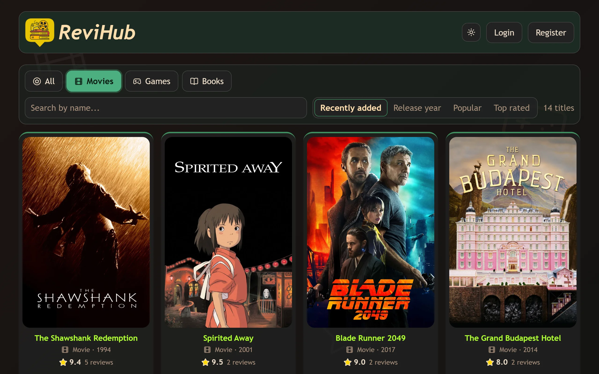

# ReviHub

[](https://github.com/vasobi14/ReviHub/actions/workflows/ci.yml)

A site for reviews of movies, games and books: browse the catalog, add a title with a cover and rate it from 1 to 10.

**Live:** https://vasobi.site



## Stack

- **Frontend:** TypeScript, React, React Router, SWR, Vite, CSS Modules
- **Backend:** Node.js, Express, Prisma, PostgreSQL, Zod, JWT
- **Tests:** Vitest, Supertest, Testcontainers
- **Infrastructure:** Docker, Docker Compose, GitHub Actions, GHCR, nginx

## Features

- Catalog with search, filters by type, sorting (newest, release year, most reviewed, top rated) and pagination.
- Reviews with a 1–10 score, edited and deleted by their authors. Each title shows its average rating.
- Cover uploads, resized and stripped of metadata in the browser before they are sent.
- Sign-up with a 6-digit email code, light and dark theme, works on phones.
- Admin panel: user management, moderation of any title or review, and request analytics with an activity feed for the whole site and for each user.

- **Auth:** a short-lived JWT access token kept in memory and a refresh token in an `httpOnly` cookie, rotated on every use and stored hashed. Login attempts are rate limited.
- **Validation and errors:** request bodies and environment variables are checked with Zod, errors go through one handler.
- **Tests:** integration tests run against a real Postgres started by Testcontainers.
- **CI/CD:** every push to `main` is tested, built into Docker images and deployed to a VPS.

## Running locally

```bash
cp .env.example .env
docker compose up --build
```

The app is on http://localhost:3000 and the API on :3001. Migrations run on startup. Verification emails go through [Resend](https://resend.com), so put a real `RESEND_API_KEY` in `.env` if you want them to arrive.

Without Docker you need Node 24 and a Postgres. Run the API and the frontend in two terminals:

```bash
cd api && cp .env.example .env && npm install && npm run db:migrate && npm run start:dev
```

```bash
cd web && npm install && npm start
```

The frontend only ever calls `/api/...` on its own origin. In development Vite proxies it to the API, in production nginx does. That avoids CORS entirely and keeps the refresh cookie same-site.

## Tests

```bash
cd api && npm run test:run
```

These are integration tests against a real Postgres that Testcontainers starts in Docker, so Docker has to be running.

## Deployment

The pipeline is in [`.github/workflows/ci.yml`](.github/workflows/ci.yml). Pull requests run steps 1–2 and only check that the images build. A push to `main` runs all of them:

1. Checks, API and frontend in parallel. The API is type-checked and tested against a real Postgres, the frontend is type-checked and built.
2. Images. Three Docker images (`api`, `migrate`, `web`) are built in parallel with layer caching and pushed to GHCR, tagged with the commit SHA.
3. Deploy. Actions connects to the VPS over SSH, checks out the compose file of the same commit and pulls its images. `docker compose up --wait` starts Postgres, runs the migrations in a one-off container and only then starts the new API.
4. Health check. The deploy succeeds once the API answers on `/health`, otherwise it fails and prints the container status. Images from earlier deploys are removed.

Deploys run one at a time, so a newer push waits for the current one to finish.

To roll back, re-run the deploy job of an older commit: its images are still in the registry. Migrations are not rolled back, so they have to stay compatible with the previous version of the code.

On the server, nginx sits in front of the containers: `/api` and `/uploads` go to the API, everything else to the frontend.

The workflow needs the repository variable `VPS_HOST` and the secrets `VPS_USER`, `VPS_SSH_KEY` and `VPS_HOST_FINGERPRINT`.